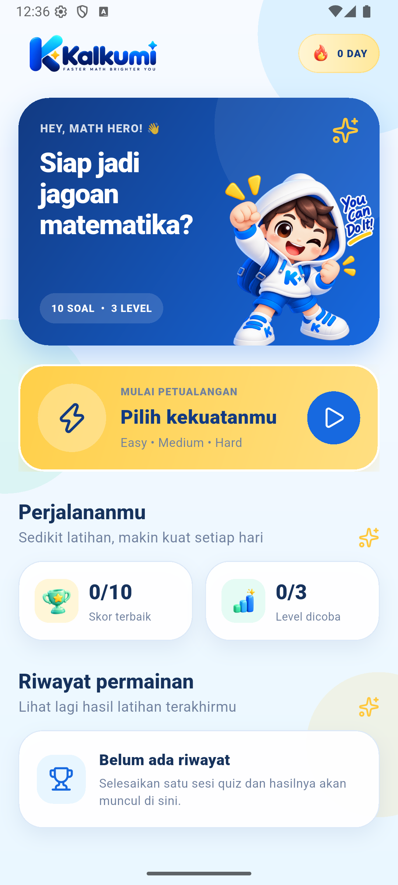
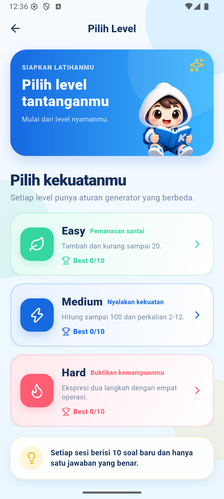
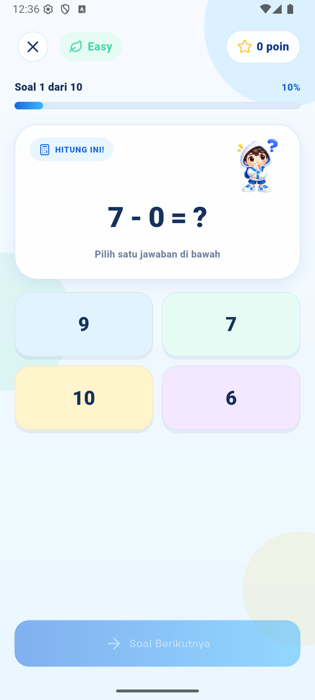
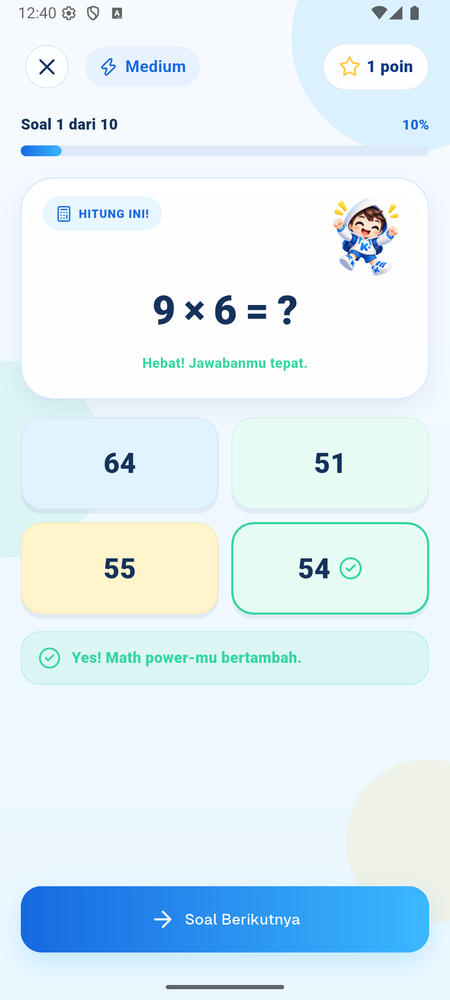
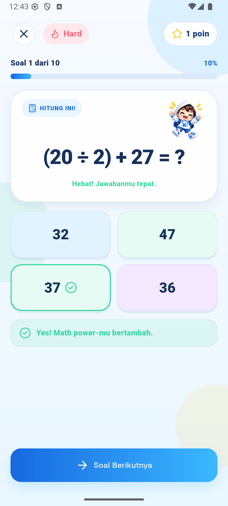
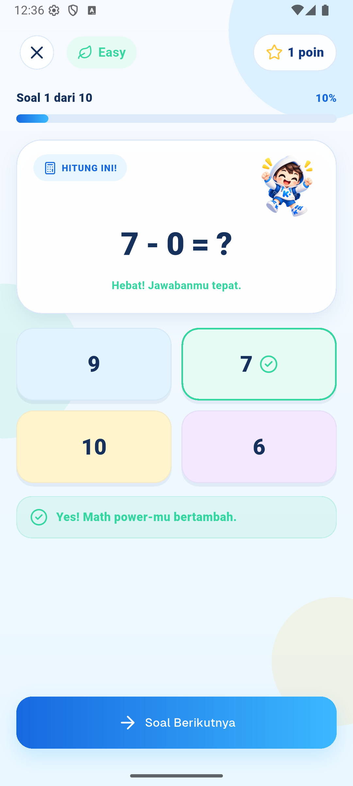
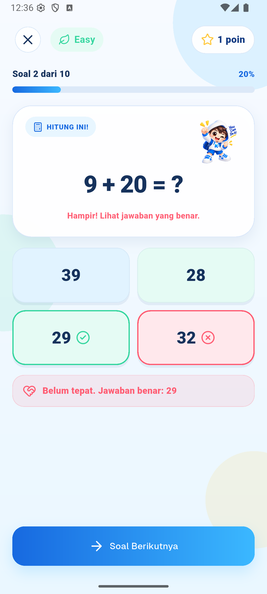
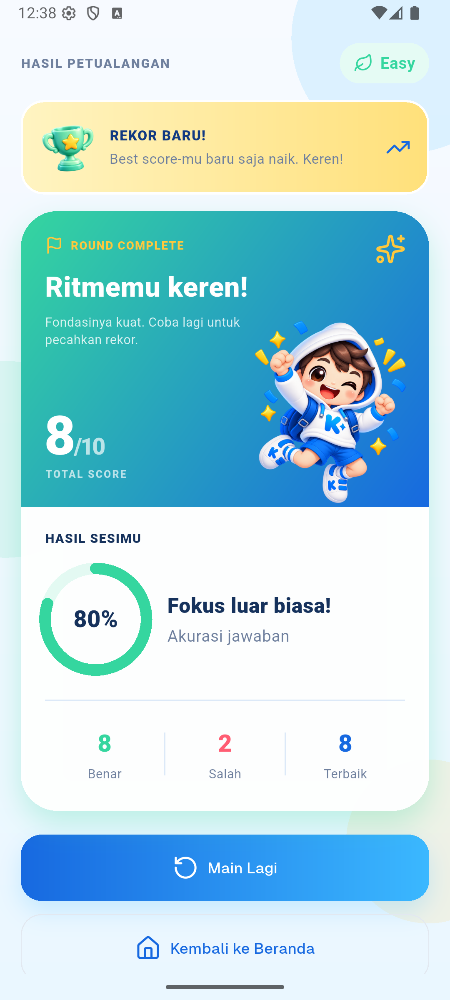
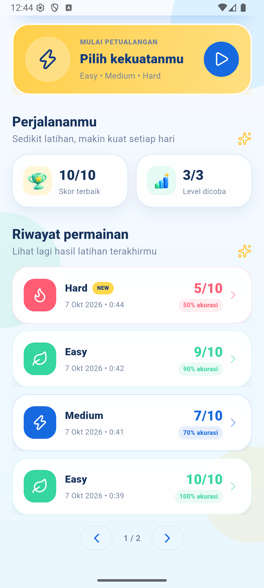
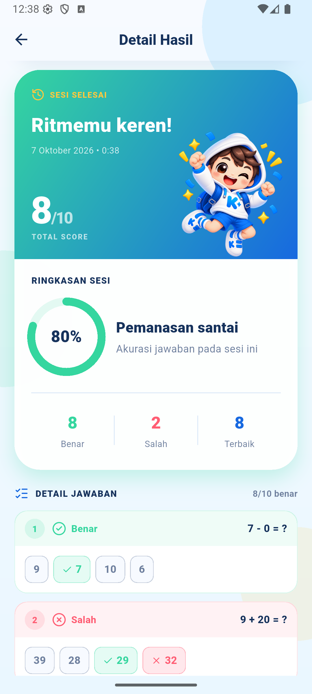

# Kalkumi

Kalkumi adalah aplikasi quiz matematika offline untuk Android. Pengguna memilih tingkat kesulitan, mengerjakan 10 soal, lalu melihat skor, best score, dan riwayat permainan.

Seluruh soal dan data dibuat serta disimpan di perangkat; tidak ada API atau koneksi internet yang dibutuhkan.

## Tampilan aplikasi

| Splash | Home | Pilih level |
|:---:|:---:|:---:|
|  |  |  |

| Easy | Medium | Hard |
|:---:|:---:|:---:|
|  |  |  |

| Jawaban benar | Jawaban salah | Result |
|:---:|:---:|:---:|
|  |  |  |

| History | Detail history |
|:---:|:---:|
|  |  |

## Video demo

[Lihat video demo Kalkumi](https://drive.google.com/file/d/1ebmUZdVWUB10ZYMsR9ab3IYu4AjG5633/view?usp=sharing)

## Fitur

- Easy, Medium, dan Hard dengan aturan soal yang berbeda.
- 10 soal acak dan unik dalam setiap sesi.
- Empat pilihan unik dengan satu jawaban benar.
- Progress, skor, dan feedback langsung selama quiz.
- Best score tersimpan terpisah untuk setiap difficulty.
- Riwayat maksimal 20 sesi dengan pagination empat item per halaman.
- Detail history berisi skor dan review setiap jawaban.
- Streak berdasarkan hari latihan yang berurutan.
- Retry saat generator atau local persistence gagal.
- Konfirmasi sebelum meninggalkan quiz yang belum selesai.

## Menjalankan project

Persyaratan:

- Flutter stable 3.38 atau lebih baru.
- Android SDK serta emulator/perangkat Android.

```bash
flutter pub get
flutter run
```

Quality check dan build APK:

```bash
flutter analyze
flutter test
flutter build apk --debug
```

APK debug akan tersedia di `build/app/outputs/flutter-apk/app-debug.apk`.

## Struktur project

```text
lib/
├── app/                  # GoRouter dan path route
├── core/theme/           # Warna, asset path, dan reusable widget
├── features/quiz/
│   ├── data/             # Generator dan repository
│   ├── domain/           # Model quiz
│   ├── logic/            # Controller/ChangeNotifier
│   └── presentation/
│       ├── screens/
│       └── widgets/
├── resources/            # String dan nilai bersama
├── app.dart
└── main.dart
```

Dependency utama bergerak satu arah:

```text
Presentation -> Controller -> Repository/Generator -> SharedPreferences
```

Screen tidak membaca `SharedPreferences` secara langsung. Repository memakai interface supaya persistence dapat diganti dan mudah dibuat fake saat test.

## UI dan state management

Flutter Material digunakan sebagai fondasi Android. `shadcn_ui` dipakai untuk komponen seperti dialog, alert, progress, dan button. Ukuran responsif menggunakan `flutter_screenutil` dengan design size `390 x 844`.

Provider mengelola tiga state utama:

- `ScoreboardController` untuk best score;
- `QuizHistoryController` untuk history dan streak;
- `QuizSessionController` untuk pertanyaan, jawaban, progress, dan skor sesi aktif.

State UI yang hanya dipakai satu widget, seperti halaman pagination dan status tombol finishing, tetap menggunakan local state. Ini menjaga controller tetap fokus pada business state.

## Question generator

`QuestionGenerator` membuat soal langsung di perangkat:

1. Memilih template berdasarkan difficulty.
2. Membuat operand dan menghitung jawaban dengan logic Dart.
3. Menolak prompt yang sudah muncul dalam sesi.
4. Membuat tiga distractor di sekitar jawaban benar.
5. Memastikan empat opsi unik, kemudian mengacak opsi dan urutan soal.

Generator menerima `Random` opsional. Production memakai random biasa, sedangkan unit test memakai seed agar hasilnya konsisten.

### Perbedaan difficulty

- **Easy:** tambah dan kurang dengan operand 0-20; hasil tidak negatif.
- **Medium:** tambah/kurang sampai 100 dan perkalian 2-12.
- **Hard:** ekspresi dua langkah dengan tanda kurung, termasuk pembagian eksak.

Pada soal pembagian, dividend dibentuk dari `divisor * quotient`, sehingga hasil selalu bilangan bulat.

## Local persistence

`SharedPreferences` menyimpan:

- `best_score_easy`, `best_score_medium`, dan `best_score_hard`;
- `kalkumi.quiz_history.v1` untuk history dalam bentuk JSON.

History diurutkan dari terbaru, dideduplikasi berdasarkan id, dan dibatasi 20 entry. Payload ini kecil dan tidak sensitif, sehingga database tambahan belum diperlukan.

## Testing

Automated test mencakup:

- jumlah, keunikan, dan aturan soal setiap difficulty;
- empat opsi unik serta keberadaan jawaban benar;
- scoring, pencegahan double answer, dan akhir sesi;
- best score per difficulty;
- serialization, sorting, deduplication, serta batas history;
- failure dan retry pada repository/controller;
- retry setelah kegagalan persistence parsial;
- perhitungan streak;
- splash dan pagination;
- flow Home -> Difficulty -> Quiz -> Result;
- flow Home -> History Detail.

## Library

- `provider`: state management dan dependency injection.
- `go_router`: navigasi.
- `shared_preferences`: persistence lokal.
- `shadcn_ui`: komponen UI.
- `flutter_screenutil`: layout responsif.
- `flutter_launcher_icons`: adaptive launcher icon.
- `flutter_native_splash`: native Android splash.

## Keputusan dan trade-off

- Generator lokal membuat aplikasi offline dan mudah diuji, tetapi balancing soal menjadi tanggung jawab aplikasi.
- Provider cukup untuk flow yang linear; BLoC atau layer use-case belum diperlukan.
- SharedPreferences sesuai untuk maksimal 20 history. Jika data berkembang dan membutuhkan query, repository dapat dipindahkan ke SQLite tanpa mengubah screen.
- Native splash dilanjutkan dengan splash Flutter singkat untuk transisi branding. Pada widget test, router langsung dibuka ke Home agar test cepat dan deterministik.
